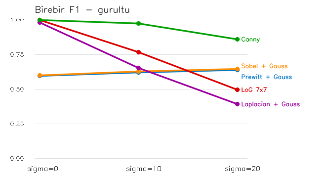

# Canny Kenar Bulucu ve Diğer Yöntemlerle Süre / Doğruluk Karşılaştırması

## 1. Canny algoritması

`CannyKenar.py`, OpenCV'nin hazır `cv2.Canny` fonksiyonunu kullanıyor. Canny, önceki görevlerde tek tek yazdığımız adımları birleştirip üzerine iki adım daha ekleyen bir **işlem hattıdır**:

| Adım | Ne yapar | Kim yapar |
|---|---|---|
| 1. Gauss yumuşatma | Gürültüyü bastırır | `cv2.GaussianBlur` (3x3). `cv2.Canny` bunu **yapmaz** |
| 2. Sobel gradyanı | \|G\| ve yön = atan2(Gy, Gx) | `cv2.Canny` (`L2gradient=True` → √(Gx²+Gy²)) |
| 3. Maksimum olmayanı bastırma | Gradyan yönündeki iki komşusundan büyük olmayan pikseli siler; Sobel'in kalın bandı tek piksele iner | `cv2.Canny` |
| 4. Çift eşik | \|G\| > 150: güçlü, 50 < \|G\| < 150: zayıf, gerisi atılır | `cv2.Canny` |
| 5. Histerezis | Zayıf kenar, yalnızca bir güçlü kenara bağlıysa kalır | `cv2.Canny` |

Eşikler 50/150 seçildi. Bu, Canny'nin önerdiği 1:2 – 1:3 oranına uyuyor.

**Histerezisin etkisi.** Cameraman üzerinde Canny'yi bir de tek eşikle (düşük = yüksek) çalıştırdım:

| | Kenar pikseli | Kenar parçası sayısı | Parça başına ortalama piksel |
|---|---|---|---|
| Tek eşik 50 | 24 323 | 2 091 | 11.6 |
| Tek eşik 150 | 6 521 | 241 | 27.1 |
| **Histerezis (50, 150)** | 11 020 | **122** | **90.3** |

Tek eşik iki kötü seçenek bırakıyor. Düşük eşik çimenleri gürültü noktalarıyla dolduruyor. Yüksek eşik ise gerçek kenarları kopuk kopuk bırakıyor. Histerezis, düşük eşiğin bulduğu zayıf kenarlardan yalnızca güçlü bir kenara bağlı olanları tutuyor. Sonuçta kenarlar en az sayıda ve en uzun parçalar hâlinde çıkıyor (`ciktilar/canny_karsilastirma.png`, sağ alttaki kırmızılar histerezisin eklediği kenarlar).

## 2. Deney düzeni

`KenarBulucuKarsilastirma.py` beş yöntemi kıyaslıyor: **Prewitt + Gauss**, **Sobel + Gauss**, **Laplacian + Gauss**, **LoG 7x7** ve **Canny**. LoG dışındakilerin hepsinde önce 3x3 Gauss uygulanıyor.

**Süre.** 512x512 cameraman resmi üzerinde iki şekilde ölçüldü:
- *OpenCV ile:* `cv2.filter2D`, `cv2.Sobel`, `cv2.Laplacian`, `cv2.Canny`. Kenar kararı (eşik ya da sıfır geçişi) numpy ile veriliyor. 50 ölçümün ortancası alındı.
- *Elle:* Önceki görevlerdeki Python döngülü konvolüsyon, 1 ölçüm.

OpenCV ve elle yazılmış sürümlerin aynı sonucu verdiği kontrol edildi (en büyük fark: 0, LoG'da 9·10⁻¹⁴).

**Doğruluk.** Cameraman'de hangi pikselin "gerçekten" kenar olduğu bilinmiyor, bu yüzden doğruluk orada ölçülemez. Onun yerine kenarları bilinen yapay bir test resmi çizdim:
- Farklı kontrastlı şekiller: disk, iç içe disk, dikdörtgen, üçgen, elips ve içinde düşük kontrastlı bir kare.
- Arka plan düz değil, hafif bir rampa.
- Resme σ = 0, 10, 20 Gauss gürültüsü eklendi.

Bulunan bir piksel, gerçek kenara en fazla 1.5 piksel uzaktaysa doğru sayıldı. Ölçüler:

- **Precision (P):** Bulunan kenarların ne kadarı gerçek.
- **Recall (R):** Gerçek kenarların ne kadarı bulundu.
- **F1:** P ile R'nin harmonik ortalaması.
- **Birebir F1:** Her gerçek kenar pikseli yalnızca *bir* bulunan pikseli doğrulayabilir. Normal F1, kalın kenarı cezalandırmaz: 3 piksellik bir bandın her pikseli gerçek kenara yakın olduğu için "doğru" sayılır. Birebir F1 ise kenarı 2.5 kat kalın çizen bir yöntemin precision'ını ~1/2.5'e düşürür. Kenar değerlendirmesinde standart olan budur.

Eşik seçimi sonucu çarpıtmasın diye her yöntemin eşiği 60 değer üzerinden tarandı ve her gürültü düzeyinde en iyi sonuç raporlandı.

## 3. Sonuçlar

### Çalışma süresi (512x512)

| Yöntem | OpenCV | Elle (Python döngüsü) | Hızlanma |
|---|---|---|---|
| Prewitt + Gauss | 6.2 ms | 2.38 s | ~380x |
| Sobel + Gauss | 5.4 ms | 2.27 s | ~420x |
| Laplacian + Gauss | 9.3 ms | 1.52 s | ~160x |
| LoG 7x7 | 13.0 ms | 3.28 s | ~250x |
| **Canny** (Gauss dahil) | **0.64 ms** | — | — |

*16 iş parçacığı, OpenCV 4.13. Ölçümler sistem yüküne göre ±%50 oynayabiliyor; sıralama değişmiyor.*

- **Elle yazılmış ve kütüphane sürümü arasındaki fark 160–420 kat.** Python yorumlayıcısı her piksel ve her çekirdek elemanı için ayrı işlem yapıyor. OpenCV ise derlenmiş C++, SIMD komutları ve çoklu iş parçacığıyla çalışıyor.
- **En karmaşık algoritma olan Canny, en hızlısı.** Diğer dört yöntemden 8–20 kat hızlı. Nedeni algoritmanın kendisi değil, gerçeklemesi:
  - Canny bütün adımları tek bir C++ fonksiyonunda, 8/16 bitlik tamsayılarla yapıyor. OpenCV'nin yalnızca Sobel'i int16 ile hesaplaması 0.47 ms sürüyor; Canny'nin tamamı da yaklaşık bu kadar.
  - Benim OpenCV sürümlerim ise float64 kullanıyor ve kararı numpy ile veriyor. Sobel ve Prewitt'te zamanın çoğu float64 karekökte geçiyor. Laplacian ve LoG'da numpy'daki sıfır geçişi adımı (8–12 ms), filtrenin kendisinden (1.5–5 ms) daha uzun sürüyor.
- Aynı koşullarda (elle yazılmış hâlde) en yavaşı **LoG**: 7x7 çekirdek piksel başına 49 çarpma gerektiriyor, 3x3 çekirdek ise 9.

### Doğruluk (yapay test resmi, 3 352 gerçek kenar pikseli)

| Yöntem | σ = 0 F1 | σ = 0 **birebir** | σ = 10 F1 | σ = 10 **birebir** | σ = 20 F1 | σ = 20 **birebir** | Bulunan / gerçek (σ = 10) |
|---|---|---|---|---|---|---|---|
| Prewitt + Gauss | 0.972 | 0.594 | 0.956 | 0.618 | **0.891** | 0.636 | 2.42 |
| Sobel + Gauss | 0.977 | 0.598 | 0.958 | 0.627 | 0.881 | 0.646 | 2.41 |
| Laplacian + Gauss | 0.982 | 0.982 | 0.651 | 0.651 | 0.391 | 0.391 | 0.51 |
| LoG 7x7 | 0.998 | 0.998 | 0.766 | 0.766 | 0.494 | 0.494 | 0.66 |
| **Canny** | **1.000** | **1.000** | **0.974** | **0.974** | 0.863 | **0.858** | **0.99** |

- **Canny en doğru yöntem.** Gürültüsüz resimde kusursuz (F1 = 1.000). σ = 10'da da birebir F1 = 0.974 ile ikinci en iyi yöntemin (LoG, 0.766) çok önünde. Bulduğu piksel sayısı gerçek kenarla neredeyse aynı (0.99): kenarı hem eksiksiz, hem tek piksel inceliğinde buluyor.
- **Sobel ve Prewitt kenarı kaçırmıyor ama kalın çiziyor.** Normal F1'de Canny'ye yakınlar; σ = 20'de Prewitt Canny'yi az farkla geçiyor bile (0.891'e karşı 0.863). Ancak gerçek kenarın 2.4 katı piksel işaretliyorlar. Kalınlık hesaba katılınca (birebir F1) her gürültü düzeyinde 0.6 civarında kalıyorlar. Sobel'in gradyan hesabı Canny ile aynı; aradaki bütün fark maksimum olmayanı bastırma ve histerezisten geliyor.
- **Laplacian ve LoG temiz resimde çok iyi, gürültüde en kötü.** σ = 0'da ince ve doğru kenar buluyorlar (LoG birebir F1 = 0.998). Gürültü arttıkça hızla çöküyorlar: σ = 20'de 0.39 ve 0.49. Sahte sıfır geçişlerini atmak için eşik yükseltildikçe gerçek kenarlar da kopuyor. Recall σ = 20'de 0.34–0.39'a iniyor. Düşük kontrastlı iç kareyi gürültülü resimde neredeyse hiç bulamıyorlar (`ciktilar/dogruluk_sigma10.png`, mavi kenarlar).
- **Eşiğe dayanıklılık.** σ = 10'da seçilen eşik sabit tutulup σ = 20'ye uygulandığında *bütün* yöntemlerin F1 değeri 0.1–0.4'e düşüyor. Canny de 0.09'a düşüyor. Yani hiçbir yöntem "bir kez ayarla, her resimde kullan" değil; eşik gürültü düzeyine göre seçilmeli. Canny'nin en iyi yüksek eşiği σ = 0'da 4, σ = 10'da 95, σ = 20'de 174 çıktı.

## 4. Değerlendirme

1. **Canny, hem en hızlı hem en doğru seçenek.** OpenCV'de 1 ms'nin altında çalışıyor. Bu deneylerde gürültüsüz ve orta gürültülü resimde açık ara en iyi sonucu verdi, yüksek gürültüde de en iyi birebir F1'i aldı. Bunu, önceki yöntemlerin zayıf yanlarını kapatarak başarıyor:
   - Sobel'in **kalın bandını** maksimum olmayanı bastırmayla inceltiyor.
   - Tek eşiğin **kopukluk ile gürültü arasındaki ikilemini** histerezisle çözüyor.
2. **Sobel / Prewitt** kenarın *nerede* olduğunu değil, *hangi bölgede* olduğunu söylüyor. Yalnızca "kenar bölgesi" maskesi gerekiyorsa ya da yön bilgisi kullanılacaksa yeterli ve gürültüye dayanıklı. Ama tek piksellik kontur gerekiyorsa tek başına uygun değil.
3. **Laplacian / LoG** temiz resimde Canny kadar ince ve doğru kenar buluyor. Ancak ikinci türev olduğu için gürültüye karşı en zayıf yöntemler; gürültülü resimde ancak daha büyük bir σ ile kullanılabilir.
4. **Elle yazmanın değeri öğrenmekte.** Aynı filtrenin Python döngüsüyle yazılmış hâli kütüphane sürümünden 160–420 kat yavaş. Gerçek uygulamalarda OpenCV kullanılmalı. Bu görevde OpenCV yalnızca ölçüm ve tarama için kullanıldı ve sonuçlarının elle yazılanlarla aynı olduğu doğrulandı.

**Sınırlamalar.** Doğruluk, keskin kenarlı yapay şekiller ve beyaz Gauss gürültüsüyle ölçüldü. Doğal resimlerde kenar tanımı belirsizdir; doku, bulanık sınırlar ve gölgeler sonuçları değiştirebilir. Bütün yöntemlere aynı 3x3 Gauss ön yumuşatması uygulandı. Canny genellikle 5x5 Gauss ile kullanılır ve yüksek gürültüde öyle daha iyi sonuç verir.

## Dosyalar

- `CannyKenar.py`: 3x3 Gauss + `cv2.Canny` (50, 150); histerezisin etkisini gösterir, sonucu pencerede açar.
- `KenarBulucuKarsilastirma.py`: süre ve doğruluk deneylerini çalıştırır, tablodaki sayıları ve görselleri üretir.
- `ciktilar/canny_karsilastirma.png`: Canny sonucu, tek eşikli sürümler ve histerezisle eklenen kenarlar.
- `ciktilar/dogruluk_sigma10.png`: σ = 10 test resminde her yöntemin doğru (yeşil), yanlış (kırmızı) ve kaçırdığı (mavi) kenarları.
- `ciktilar/f1_gurultu_grafigi.png`: gürültü düzeyine göre birebir F1.
- `ciktilar/cameraman_tum_yontemler.png`: beş yöntemin cameraman üzerindeki sonucu.
